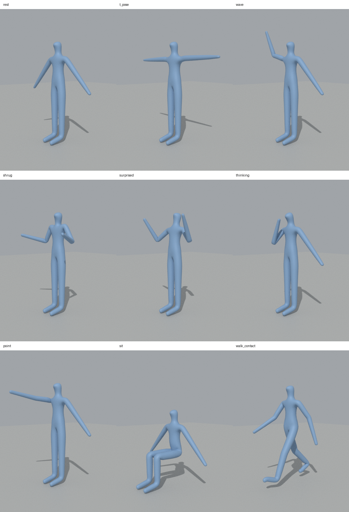

# Blenda Labs: Prompt-to-3D-Animation Prototype (Take-Home Test)

Welcome, and thanks for taking the time. This test mirrors the kind of work we do at Blenda Labs: AI generates a starting point, and a creative technologist makes it controllable, reliable and good.

## The task

**Build a prototype app where a user types a prompt (e.g. "the character waves hello, then looks surprised") and a rigged Blender humanoid performs it as a keyframed animation, with a preview or render.**

## What we provide

- An LLM API key with a spending cap. Never commit it to the repo; load it from an environment variable.
- The starter rig, in [`rig/`](rig/):
  - [`humanoid_rig.blend`](rig/humanoid_rig.blend): armature `Humanoid_Rig` (22 named bones) and mesh `Humanoid_Mesh`, in an A-pose.
  - [`REFERENCE.md`](rig/REFERENCE.md): conventions, bone table, rotation limits, and which way each axis moves each bone. Read this first.
  - [`poses.json`](rig/poses.json): nine reference poses (`rest`, `t_pose`, `wave`, `shrug`, `surprised`, `thinking`, `point`, `sit`, `walk_contact`) as per-bone Euler rotations in degrees. You may use them as a pose library or as examples for your prompt.
  - [`pose_sheet.png`](rig/pose_sheet.png): a preview of all nine poses.



## Setup

- Python 3.13. The `bpy` wheel must match your Python version, so other versions will fail to install.
- Install Blender's Python module in a virtual environment: `pip install -r requirements.txt` (pins `bpy==5.2.3`). Installing Blender itself and using its bundled Python also works if you prefer.
- Verify the rig loads:

  ```bash
  python -c "import bpy; bpy.ops.wm.open_mainfile(filepath='rig/humanoid_rig.blend'); print([b.name for b in bpy.data.objects['Humanoid_Rig'].pose.bones])"
  ```

- Rendering works headless with the `bpy` module. The Eevee engine needs a working GPU/OpenGL driver; if it fails on your machine, Cycles on CPU works (slower) and is fine for this test.

## Rig rules

The details are in [`rig/REFERENCE.md`](rig/REFERENCE.md); the essentials:

- Z is up, the character faces -Y, and the character's left side is +X (bones ending in `.L`).
- All pose bones use Euler XYZ, local rotations. Use degrees in your JSON and convert to radians for Blender.
- Only `root` and `hips` take location; every other bone is rotation only.
- Elbows and knees bend in negative X. Limit Rotation constraints enforce joint limits and clamp values outside them. Do not remove the constraints; your validation should handle limits before they are hit.

## Core requirements

1. **Prompt input:** a simple UI (web, CLI, or Blender add-on panel, your choice).
2. **AI layer:** the LLM must return *structured data* (e.g. JSON with bone rotations, timing and easing), not freeform Python. Validate it before use.
3. **Blender layer:** a `bpy` script (headless or add-on) reads that data and inserts keyframes on the humanoid's bones, with easing and sensible limits so limbs don't break.
4. **Output:** a playable preview (viewport capture or Eevee render, 3-5 seconds).
5. **Failure handling:** bad LLM output, impossible poses and ambiguous prompts should fail gracefully.

## Stretch goals (optional)

- A pose library the LLM can reference ("wave", "shrug", "sit") instead of raw rotations
- Iterating on a result ("make it slower", "more energetic")
- Export in a format usable for an image-to-video step
- Chaining multiple prompts into one sequence

## Constraints

- **Time box:** 6-8 hours, spread over about 3-5 days. Please don't go over; tell us what you'd do with more time instead.
- **Stack:** any language or framework for the app layer. The Blender side must be Python (`bpy`).
- **AI tools:** any AI coding tools are allowed, but you must disclose which ones you used.
- **Security:** do not execute arbitrary LLM-generated code unsandboxed. How you handle this is part of the evaluation.
- **Originality:** use only the provided rig and your own work. No existing IP or licensed characters.

## Deliverables

1. **Source code** with a README covering setup, how to run, and architecture. We should be able to run it from your instructions alone.
2. **Screen recording (2-3 min)** showing the app working on at least 5 different prompts, including 1-2 that fail or look bad.
3. **Short write-up (about half a page):** design decisions, limitations, and what you'd build next.

Send a zip or a link to a private repo.

## What we look for

- **Prompt and schema design:** structured, constrained output, and visible iteration
- **Blender integration:** clean `bpy` code, correct bone handling, reproducible setup
- **Animation quality:** natural timing and easing, believable poses, no broken deformation
- **Robustness:** validation, error handling, sensible fallbacks
- **Architecture and code quality:** readable, modular, runnable from your README
- **Product thinking:** a usable UI and sensible scope for the time box
- **Communication:** honesty about limits and clear next steps

Getting *a* result is easy. Getting a *reliably good* one is the real skill.

## Questions?

If something in the brief is unclear, ask your recruiting contact. Making a reasonable assumption and noting it in your write-up is also fine.
